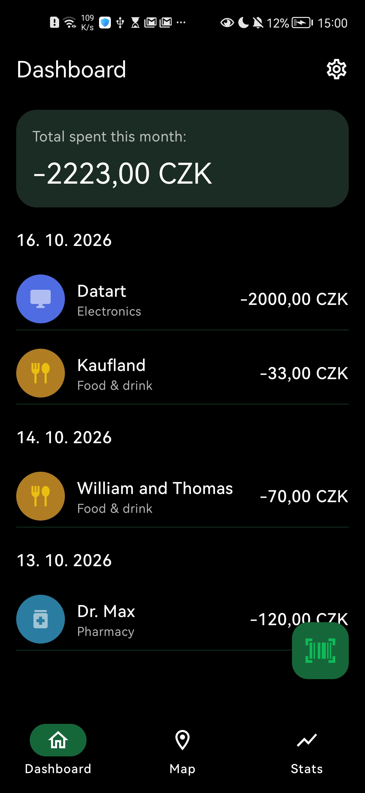
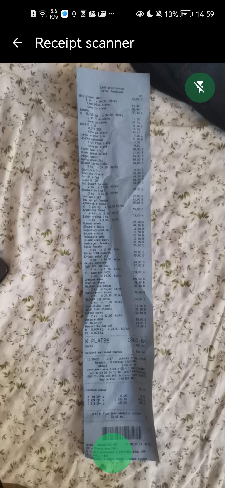
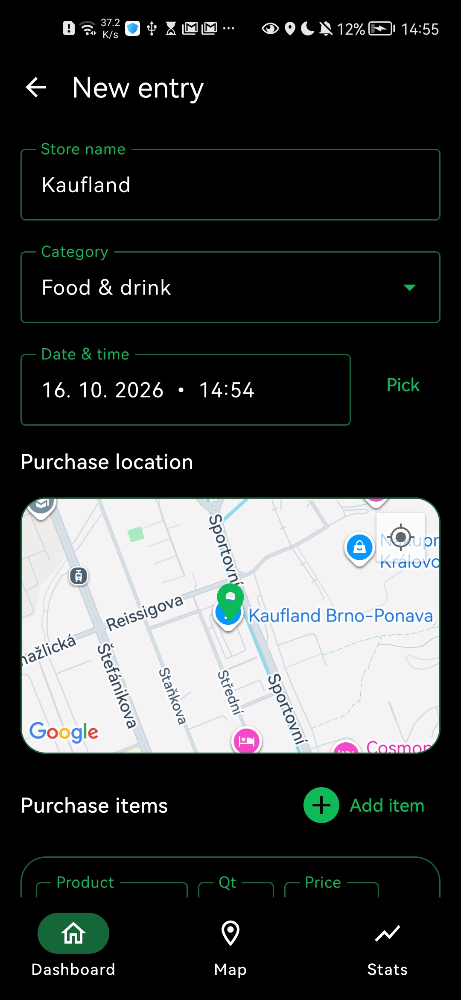
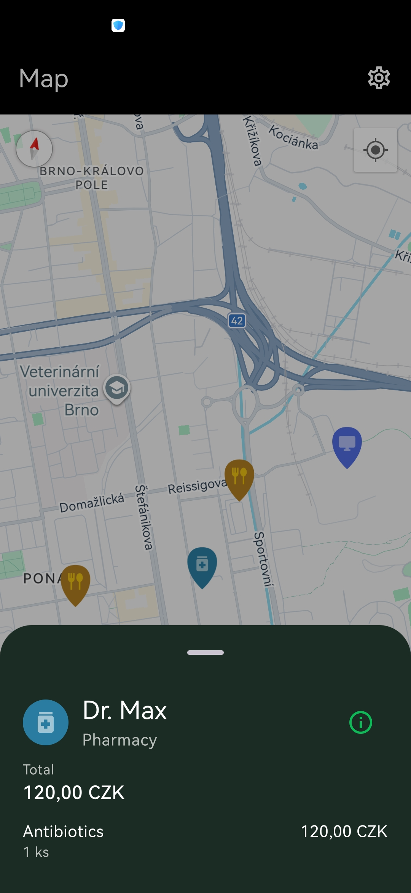
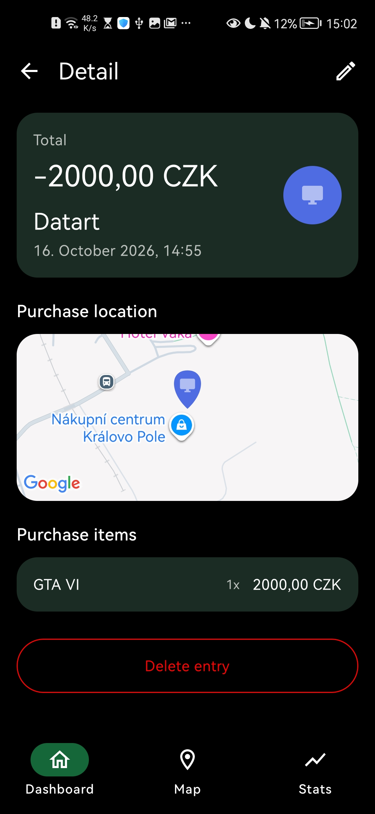
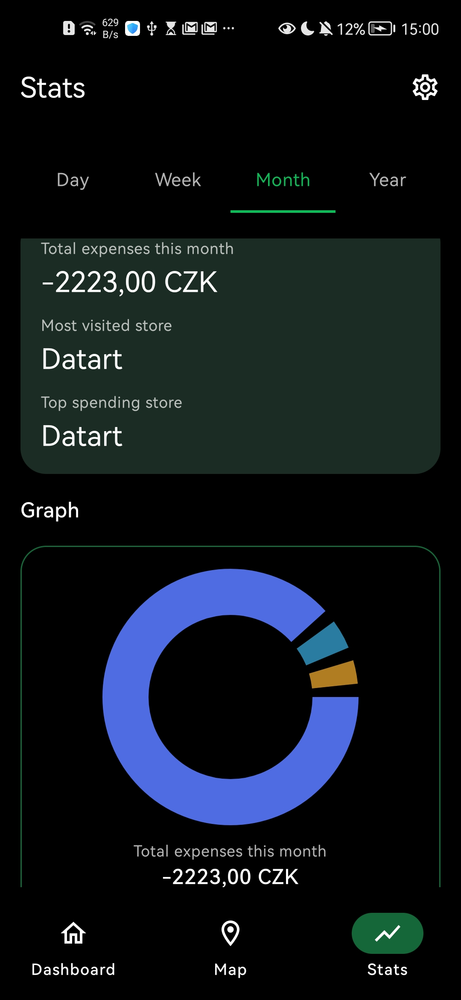

# SpendRadar

A modern native Android application for tracking personal expenses. SpendRadar simplifies budget management by allowing users to manually log purchases or use AI-powered receipt scanning to automatically extract transaction details.

## Features

* **AI Receipt Scanning:** Snap a photo of a physical receipt and let the Gemini API automatically parse the items, quantities, and prices for quick entry.
* **Dashboard Overview:** View your total monthly spending and a chronological feed of your recent transactions at a glance.
* **Interactive Map:** Visualize where your money goes with an integrated Google Map. Map markers are color-coded based on expense categories (e.g., Electronics, Food & Drink, Pharmacy).
* **Detailed Manual Entry:** Log expenses manually with custom Material 3 date and time pickers. Pinpoint the exact purchase location on the map and categorize the transaction.
* **Comprehensive Statistics:** Analyze your spending habits across day, week, month, or year timeframes. The app automatically calculates your most visited and top spending stores, visualized alongside interactive pie charts.
* **Transaction Details:** Review past purchases to see specific items bought (e.g., GTA VI) and the exact store location.

## Screenshots

  
  
  
  
  
  

## Tech Stack & Architecture

* **Platform:** Native Android (Kotlin)
* **UI Framework:** Jetpack Compose with Material Design 3
* **Architecture:** MVVM (Model-View-ViewModel)
* **Local Storage:** Room Database
* **Dependency Injection:** Hilt
* **AI Integration:** Google Gemini API (for receipt text parsing and data extraction)
* **Maps:** Google Maps SDK for Android
